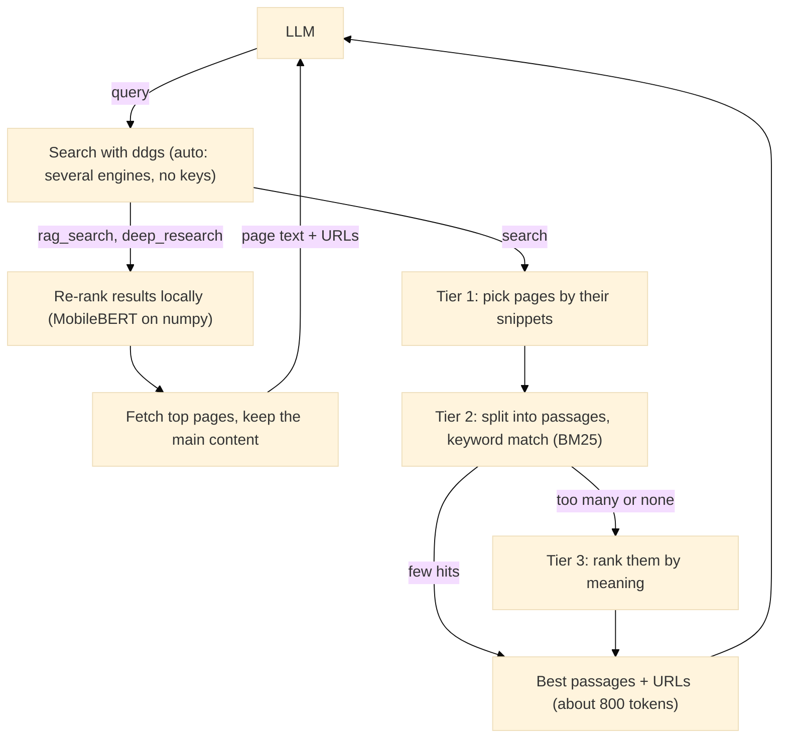
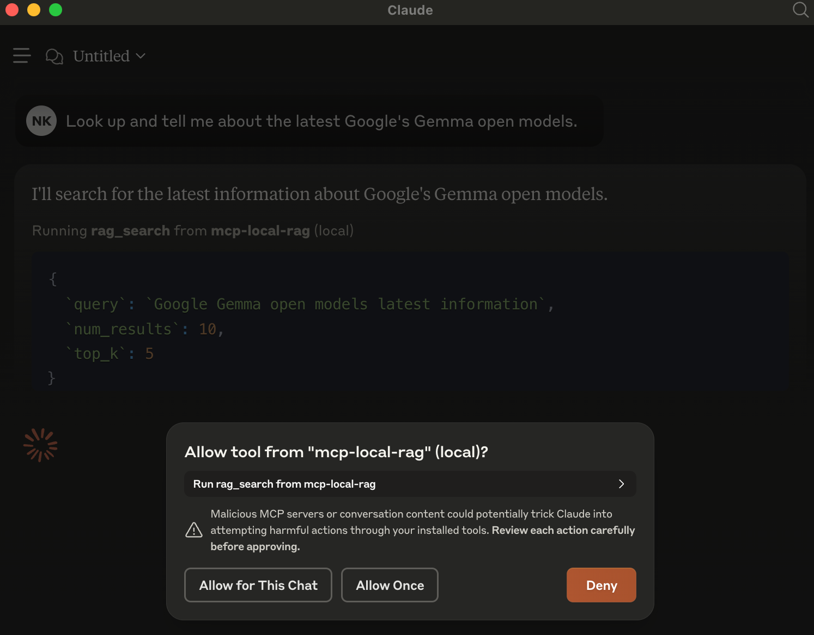
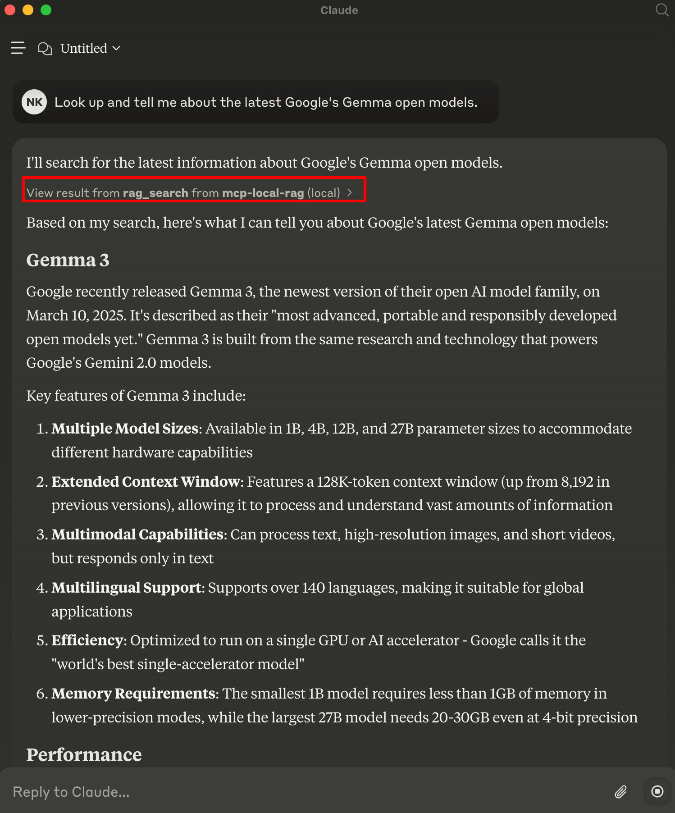

<p align="center"></p>

Local web search for your LLM over MCP. No API keys, and results are ranked on your machine. _Formerly [`mcp-local-rag`](https://github.com/nkapila6/mcpsurfr/tree/main-bak)._

[](https://lmstudio.ai/install-mcp?name=mcpsurfr&config=eyJjb21tYW5kIjoidXZ4IiwiYXJncyI6WyItLWZyb20iLCJnaXQraHR0cHM6Ly9naXRodWIuY29tL25rYXBpbGE2L21jcHN1cmZyIiwibWNwc3VyZnIiXX0%3D) [](https://deepwiki.com/nkapila6/mcpsurfr) [](https://ko-fi.com/X8X51MK4A1)



What's in it:

- **No API keys.** Searches go through [ddgs](https://github.com/deedy5/ddgs). Its `auto` mode asks several engines at once and skips blocked ones.
- **Ranked locally.** A small MobileBERT model on plain numpy re-ranks results, so only the best pages get fetched.
- **Clean text.** Pages are fetched with browser impersonation, and only the main content is kept: no menus, cookie banners or footers. Code blocks and tables keep their lines. The same page under two URLs comes back once.
- **Passages instead of pages.** `search` returns just the paragraphs that answer the question, about a tenth of the tokens. When nothing matches well, it can ask you whether you want the full pages instead.
- **Says what it left out.** Results list skipped pages with a reason (blocked, PDF, duplicate...), cut pages are marked `truncated`, and fallbacks and engine failures show up as `warnings`. Google blocks often, so it falls back to `auto` on its own.
- **Brings its own guide.** It serves a skill and a `research` prompt, so clients pick up how to use it without setup.

| Tool | Use it for |
|---|---|
| `search` | Start here: returns only the relevant passages. Pass `keywords` for better hits |
| `rag_search_ddgs` | Full pages as text (the original mode) |
| `rag_search_google` | Same, via Google (falls back to `auto` when blocked) |
| `deep_research` | Several search terms across backends, merged and de-duplicated |
| `deep_research_ddgs` / `deep_research_google` | `deep_research` shortcuts |

Backends: `auto` (default), `brave`, `duckduckgo`, `google`, `grokipedia`, `mojeek`, `startpage`, `wikipedia`, `yahoo`. `auto` and `brave` are the dependable ones.

## Install

With [uv](https://docs.astral.sh/uv/):

```json
{
  "mcpServers": {
    "mcpsurfr": {
      "command": "uvx",
      "args": ["--from", "git+https://github.com/nkapila6/mcpsurfr", "mcpsurfr"]
    }
  }
}
```

Or with Docker (amd64 and arm64):

```json
{
  "mcpServers": {
    "mcpsurfr": {
      "command": "docker",
      "args": ["run", "--rm", "-i", "--init", "ghcr.io/nkapila6/mcpsurfr:latest"]
    }
  }
}
```

Full-page tools share a 40k-character budget per call (about 10k tokens). To change it, add `"env": {"MCPSURFR_MAX_CHARS": "80000"}` to the server entry.

Not sure where your config lives? See the [MCP quickstart](https://modelcontextprotocol.io/quickstart/user). Tested with Claude Desktop, Claude Code, Cursor and Goose.

**Coming from `mcp-local-rag`?** Your old config keeps working, since the old URL redirects and the `mcp-local-rag` command still exists. Switching to the config above gets you the new name and drops the `--python=3.10` pin (3.10 reaches end of life this month).

## Skill and prompt

The [`mcpsurfr-search`](src/mcpsurfr/skills/mcpsurfr-search/SKILL.md) skill tells the model which tool and backend to pick and how to cite. The server serves it as `skill://mcpsurfr-search/SKILL.md`, so most clients need nothing extra. To add it to Claude Desktop by hand: **Settings → Skills → Add from folder**, then pick `src/mcpsurfr/skills/mcpsurfr-search/`.

The `research(topic)` prompt plans a few search terms, runs `deep_research` and writes a cited summary.

## Example

Asking Claude Desktop about something newer than its training data:




---

[Security audit by MseeP](https://mseep.ai/app/nkapila6-mcp-local-rag) · Issues and PRs welcome · MIT licensed · [Buy me a coffee](https://ko-fi.com/X8X51MK4A1) if it helps you
