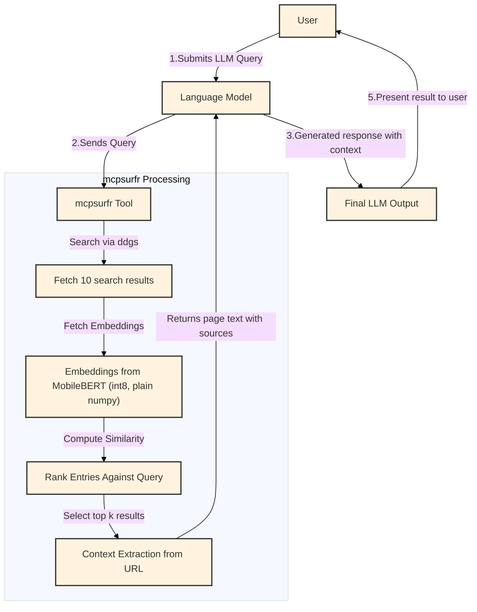

<p align="center"></p>

_Formerly [`mcp-local-rag`](https://github.com/nkapila6/mcpsurfr/tree/main-bak)._ "primitive" RAG-like web search model context protocol (MCP) server that runs locally. ✨ no APIs ✨

A RAG-based web search and deep research model context protocol (MCP) server that runs entirely locally. Features multi-engine research across 9+ search backends with semantic similarity ranking, and requires no API keys.

[](https://codespaces.new/nkapila6/mcpsurfr)

[](https://lmstudio.ai/install-mcp?name=mcpsurfr&config=eyJjb21tYW5kIjoidXZ4IiwiYXJncyI6WyItLWZyb20iLCJnaXQraHR0cHM6Ly9naXRodWIuY29tL25rYXBpbGE2L21jcHN1cmZyIiwibWNwc3VyZnIiXX0%3D)

[](https://deepwiki.com/nkapila6/mcpsurfr)

- [Features](#features)
  - [What it does](#what-it-does)
- [Installation](#installation)
    - [Run Directly via `uvx`](#run-directly-via-uvx)
    - [Using Docker (recommended)](#using-docker-recommended)
- [Agent Skills](#agent-skills)
- [Security audits](#security-audits)
- [MCP Clients](#mcp-clients)
- [Examples on Claude Desktop](#examples-on-claude-desktop)
  - [Result](#result)
- [Contributing](#contributing)
- [License](#license)




# Features

## What it does
- **Search without API keys**: searches go through [ddgs](https://github.com/deedy5/ddgs). The default is its "auto" mode, which queries several engines at once and skips any that are blocked.
- **Local re-ranking**: results are re-ranked on your machine by semantic similarity to the query (a small MobileBERT model on plain numpy). Only the best pages get fetched.
- **Clean page text**: pages are fetched with browser impersonation, and only the main content is kept (no nav menus, cookie banners or footers), up to 10k characters per page.
- **Deep research**: several search terms across several engines, de-duplicated and ranked together.
- **Talks back**: clients get progress while a search runs and warnings when an engine comes back empty. Google often blocks scrapers, so it falls back to "auto" on its own.
- **Ships its own skill and a `research` prompt**: clients that support MCP resources and prompts pick them up automatically.

### Tools

| Tool | What it's for |
|---|---|
| `rag_search_ddgs` | Default web search (ddgs "auto" metasearch) |
| `rag_search_google` | Google search, with automatic fallback when Google blocks |
| `deep_research` | Multiple search terms across chosen backends (default "auto") |
| `deep_research_ddgs` / `deep_research_google` | `deep_research` shortcuts |

Backends for `deep_research`: `auto`, `brave`, `duckduckgo`, `google`, `grokipedia`, `mojeek`, `startpage`, `wikipedia`, `yahoo`. In practice `auto` and `brave` are the dependable ones. Google, Startpage and Mojeek block scrapers often.

# Installation
Locate your MCP config path [here](https://modelcontextprotocol.io/quickstart/user) or check your MCP client settings. 

### Run Directly via `uvx`
This is the easiest and quickest method. You need to install [uv](https://docs.astral.sh/uv/) for this to work. <br>
Add this to your MCP server configuration:
```json
{
  "mcpServers": {
    "mcpsurfr":{
      "command": "uvx",
        "args": [
          "--from",
          "git+https://github.com/nkapila6/mcpsurfr",
          "mcpsurfr"
        ]
      }
  }
}
```

### Using Docker (recommended)
Ensure you have [Docker](https://www.docker.com) installed.<br>
Add this to your MCP server configuration:
```json
{
  "mcpServers": {
    "mcpsurfr": {
      "command": "docker",
      "args": [
        "run",
        "--rm",
        "-i",
        "--init",
        "-e",
        "DOCKER_CONTAINER=true",
        "ghcr.io/nkapila6/mcpsurfr:latest"
      ]
    }
  }
}
```

# Agent Skills

The server ships a skill, [`mcpsurfr-search`](src/mcpsurfr/skills/mcpsurfr-search/SKILL.md), that tells the model which tool and backend to pick, how to write search terms, and how to cite what it finds.

You usually don't need to install it. The server exposes it as an MCP resource (`skill://mcpsurfr-search/SKILL.md`), so clients that read resources get it automatically. To add it to Claude Desktop by hand: **Settings** → **Skills** → **Add Skill** → **Add from folder**, then pick `src/mcpsurfr/skills/mcpsurfr-search/`.

There's also a `research` prompt (`research(topic)`): it plans a few search terms, runs `deep_research` and writes a cited summary. Clients that support prompts show it as a slash command.

# Security audits
MseeP does security audits on every MCP server, you can see the security audit of this MCP server by clicking [here](https://mseep.ai/app/nkapila6-mcp-local-rag).

<a href='https://mseep.ai/app/nkapila6-mcp-local-rag'></a>

# MCP Clients
The MCP server should work with any MCP client that supports tool calling. Has been tested on the below clients.

- Claude Desktop
- Cursor
- Goose
- Others? You try!

# Examples on Claude Desktop
When an LLM (like Claude) is asked a question requiring recent web information, it will trigger `mcpsurfr`.

When asked to fetch/lookup/search the web, the model prompts you to use MCP server for the chat.

In the example, have asked it about Google's latest Gemma models released yesterday. This is new info that Claude is not aware about.


## Result
`mcpsurfr` performs a live web search, extracts context, and sends it back to the model—giving it fresh knowledge:


## Buy Me A Coffee
If the software I've built has been helpful to you. Please do buy me a coffee, would really appreciate it! 😄

[](https://ko-fi.com/X8X51MK4A1)

# Contributing
Have ideas or want to improve this project? Issues and pull requests are welcome!

# License
This project is licensed under the MIT License.
